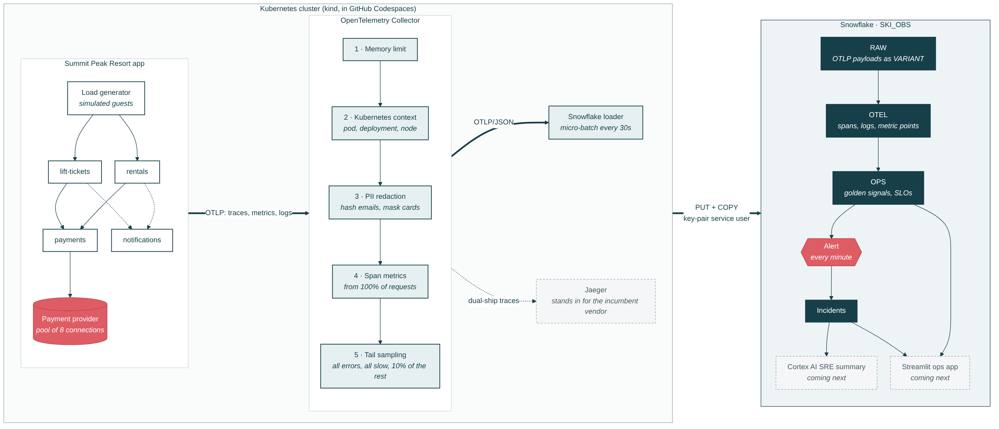

# Observability on Snowflake

An end-to-end observability lab: a small Kubernetes app instrumented with OpenTelemetry, a Collector pipeline that protects guest data and controls volume, and Snowflake as the place where traces, metrics and logs become golden signals, SLOs, alerts and incidents.

The app belongs to **Summit Peak Resort**, a fictional ski area. Guests buy lift tickets and rent gear; every purchase goes through a payment provider with a small connection pool. On a quiet day that's fine. On a powder day, with the provider running slow, the pool runs out, checkouts time out, and an alert in Snowflake opens an incident. The lab exists to catch that moment and explain it.



> All data is synthetic. Guest names, emails and card numbers are generated, and the card numbers are standard test numbers.

## What it demonstrates

| Area | In this repo |
|---|---|
| **Instrumentation** | Four Python services with OpenTelemetry traces, metrics and logs, exported over OTLP. Logs carry trace IDs, so every log line links to its request. |
| **Collector design** | Memory limiting, Kubernetes metadata, PII redaction, request metrics computed *before* sampling, and tail sampling that keeps every error and every slow trace. ([collector/collector.yaml](collector/collector.yaml)) |
| **Data protection** | Guest emails are hashed and card numbers masked at the Collector, so PII never reaches any backend. A Snowflake masking policy adds a second layer for log text. |
| **Snowflake as the telemetry store** | Raw OTLP kept as VARIANT; views flatten it into spans, logs and metric points; golden signals per service per minute. |
| **SLOs and alerting** | SLOs stored as data, a Snowflake alert that opens and resolves incidents on its own, and a 14-day retention task. |
| **Migration pattern** | Traces are dual-shipped to Snowflake and to Jaeger, which stands in for an incumbent vendor during a cutover. |
| **Cost and access control** | Separate ingest and query warehouses, a resource monitor, a key-pair service user that can only load data, and roles from analyst to admin. |

## Run it

The lab runs in GitHub Codespaces, so there's nothing to install.

### 1. Start the lab

1. On this repo, choose **Code → Codespaces → Create codespace on main**. A 4-core machine is enough.
2. When the terminal says *Ready*, run:
   ```bash
   make up        # creates the cluster, builds the images, deploys everything (~5 min)
   make status    # pods, current traffic, and what the loader has received
   make jaeger    # opens the Jaeger UI on port 16686
   ```

At this point telemetry flows through the Collector to Jaeger, and the loader keeps files locally until Snowflake is connected.

### 2. Connect Snowflake

1. In Snowsight, run [`snowflake/00_setup.sql`](snowflake/00_setup.sql) as `ACCOUNTADMIN`.
2. In the Codespace terminal, run `make keys`. Copy the `ALTER USER ...` line it prints and run it in Snowflake.
3. Run [`01_raw.sql`](snowflake/01_raw.sql) through [`05_alerts.sql`](snowflake/05_alerts.sql) in order.
4. Put your account identifier in `.env` (`SNOWFLAKE_ACCOUNT=ORGNAME-ACCOUNTNAME`), then run `make snowflake-secret`.
5. After two or three minutes, run [`06_check.sql`](snowflake/06_check.sql): rows landing, spans by service, a redaction check, golden signals, and masking by role.

### 3. Run the powder-day incident

```bash
make incident   # 30 requests/second and a slow payment provider
make status     # watch checkouts turn into 504s
make recover    # the provider recovers
make calm       # back to a quiet day
```

Within a few minutes of `make incident`, `SKI_OBS.OPS.INCIDENTS` gets a new row for the services breaching their error-rate objective. It resolves itself after the services have been healthy for a full SLO window.

When you're done: `make down` deletes the cluster, and `ALTER ALERT SKI_OBS.OPS.SLO_WATCH SUSPEND;` stops the alert from waking a warehouse. [`99_teardown.sql`](snowflake/99_teardown.sql) removes everything from Snowflake.

## Repository layout

```
services/        The resort app: four FastAPI services and a load generator (one image)
collector/       OpenTelemetry Collector configuration
loader/          Receives OTLP/JSON from the Collector and micro-batches it into Snowflake
k8s/             Kubernetes manifests (kind cluster, app, Collector, loader, Jaeger)
snowflake/       Setup, models, golden signals, governance, alerts, checks, teardown
docs/            Architecture diagram and study notes
```

## Design notes

A few choices worth calling out. Full decision records are in progress in `docs/adr/`.

- **Redact at the edge.** The Collector is the one place every signal passes through, so PII rules live there once instead of in every service and every backend.
- **Count before you sample.** Tail sampling keeps all failed traces and 10% of healthy ones, which is great for debugging and terrible for error rates. Request and error counts come from the Collector's span metrics, computed from 100% of spans before sampling.
- **Keep the raw payload.** RAW tables store each OTLP request unchanged as VARIANT. New attributes never need a schema change, and every model can be rebuilt.
- **Lab-scale ingestion, on purpose.** The loader uses PUT + COPY every 30 seconds because it's simple and easy to inspect. At production volume, Snowpipe Streaming would replace it.
- **One Collector replica.** Tail sampling needs every span of a trace on the same Collector. At scale, a load-balancing tier would route spans by trace ID.
